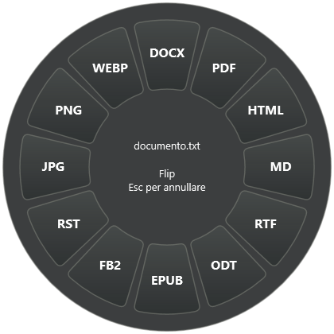

[English](README.md) · **Italiano**

# FLIP v0.6.3 — AURA Edition


[](LICENSE)
[](https://www.buymeacoffee.com/1berimHY9M)

FLIP è un convertitore locale per Windows. Trascina uno o più file da Esplora file o dal Desktop, premi **Freccia giù** (o il tasto configurato) e rilascia sul formato desiderato nella ruota. Per impostazione predefinita, FLIP salva la copia convertita accanto all'originale.



[Video dimostrativo](docs/assets/flip-demo.mp4) · [Note di rilascio della v0.6.3](https://github.com/thetinyfoundry/FLIP/releases/tag/v0.6.3) · [Registro delle modifiche](CHANGELOG.md) · [Guida Windows](docs/WINDOWS-INSTALL.md)

## Installa o aggiorna alla v0.6.3

1. Installa il [.NET 10 Windows Desktop Runtime x64](https://dotnet.microsoft.com/download/dotnet/10.0) su Windows 10 o 11 x64.
2. Scarica [`Flip-0.6.3-win-x64.zip`](https://github.com/thetinyfoundry/FLIP/releases/download/v0.6.3/Flip-0.6.3-win-x64.zip) dalla [release v0.6.3](https://github.com/thetinyfoundry/FLIP/releases/tag/v0.6.3) ed estrai tutto l'archivio.
3. Chiudi FLIP ed esegui `Installa-FLIP.cmd` dalla cartella estratta. Il programma di installazione verifica il pacchetto e lo copia in `%LOCALAPPDATA%\Programs\Flip`.

**Usi già FLIP? Aggiorna tutti i file dell'app alla v0.6.3.** Avvia il programma di installazione dal nuovo archivio. Per un'installazione manuale, sostituisci l'intera cartella dell'app con il contenuto della nuova cartella `payload`. Tieni documenti e impostazioni separati dalla cartella dell'app. Dalla v0.6.3 in poi puoi aggiornare anche da **Impostazioni → Guida & Scorciatoie → Aggiornamenti**. FLIP contatta GitHub solo quando premi il pulsante.

Per disinstallare FLIP, esegui `Disinstalla-FLIP.cmd` dal pacchetto estratto.

## Novità di AURA Edition

- **Aura ai bordi dello schermo e ruota radiale.** La ruota segue il cursore tra i monitor. Premi **Tab** o usa la rotellina per passare dai formati agli strumenti rapidi, anche quando la ruota è stata aperta con la pressione prolungata. Una selezione mista si può suddividere per tipo di file.
- **Anteprima rapida.** Premi **Spazio** durante il trascinamento. Esplora i modelli 3D con vista orbitale e tavola a quattro viste, consulta la palette delle immagini e visualizza testo e forme d'onda.
- **Apertura con pressione prolungata.** Attiva l'opzione in *Attivazione & Input* e tieni premuto il click su un file selezionato in Esplora File o sul Desktop (default 3 secondi, regolabile) per aprire la ruota senza premere alcun tasto. Dopo mezzo secondo appare un piccolo anello progressivo; per uscire dalla ruota premi il tasto destro del mouse o Esc.
- **Strumenti rapidi.** Ritaglia, ruota, ridimensiona, sfoca aree sensibili, unisci PDF, rimuovi sfondi, estrai testo con OCR e raccogli i risultati in ZIP o, se WinRAR è installato, in RAR. Le cartelle selezionate diventano archivi accanto alla cartella originale.
- **Motori facoltativi.** Se un formato selezionato richiede un motore non installato, FLIP chiede se installarlo prima di avviare la conversione.
- **PDF per l'archiviazione e trascrizione senza connessione.** Converti i file compatibili in PDF/A-2b. **Unisci PDF** conserva dimensione e orientamento originali di ogni pagina; con **A** puoi scegliere `Originale`, A4 o A3, verticale o orizzontale. Con il motore facoltativo Whisper puoi trascrivere audio e video in TXT o SRT sul tuo PC.
- **Impostazioni e accessibilità.** Dall'Hub puoi configurare la ruota, le destinazioni, i motori facoltativi, le cartelle monitorate e le ricette. Chi usa un dispositivo Tobii può abilitare la selezione con lo sguardo.

## Formati e motori

| Categoria | Esempi | Motore |
| --- | --- | --- |
| Immagini | PNG, JPEG, WebP, BMP, TIFF, GIF, ICO | Integrato |
| PDF e documenti | PDF/A-2b, pagine PDF come immagini, estrazione testo, DOCX, ODT, Markdown | Integrato, Pandoc o LibreOffice secondo la conversione |
| Dati strutturati | JSON, JSONL, YAML, TOML, XML, CSV, TSV, INI, XLSX | Integrato |
| 3D e vettoriale | OBJ, FBX, STL, PLY, GLB, GLTF, 3MF, DAE, SVG, DXF | Integrato |
| Archivi | ZIP, TAR, GZ, TGZ, CBZ, 7Z | Integrato |
| Audio e video | MP3, WAV, FLAC, MP4, MKV, WebM, trascrizioni TXT e SRT | FFmpeg, supporto multimediale di Windows o Whisper secondo la conversione |

I formati di uscita dipendono dai file selezionati e dai motori installati. La conversione avviene sul tuo PC. FLIP elabora i file in una cartella temporanea e salva i risultati nella destinazione configurata.

## Compilazione da sorgente

Installa il [.NET 10 SDK x64](https://dotnet.microsoft.com/download/dotnet/10.0).

```powershell
dotnet build src/Flip/Flip.csproj -c Release -warnaserror
dotnet run --project src/Flip/Flip.csproj -c Release --no-build -- --test-input
dotnet run --project src/Flip/Flip.csproj -c Release --no-build -- --test-conversions
```

[Architettura](ARCHITECTURE.md) · [Come contribuire](CONTRIBUTING.md)

## Contributi

Grazie a [@AlphaGolf-sec](https://github.com/AlphaGolf-sec) per la correzione del secondo avvio nella v0.6.1 e per gli aggiornamenti dall'app nella v0.6.3, e a [@giovamolinaro](https://github.com/giovamolinaro) per la correzione YAML, XML e CSV nella v0.6.2.

## Supporto

<a href="https://www.buymeacoffee.com/1berimHY9M"></a>

## Licenza

Dalla v0.6.0, il codice originale e le risorse di FLIP sono distribuiti con licenza [GNU GPLv3](LICENSE) (`GPL-3.0-only`). Copyright © 2026 The Tiny Foundry / Raffaele Acanfora. I [componenti di terze parti](THIRD_PARTY_NOTICES.md) conservano le rispettive licenze.
