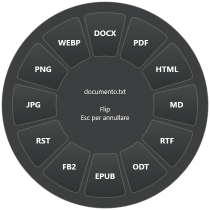

# Flip for Windows

**0.4.0-beta.3 — local beta candidate; not yet a public binary release.**

Drag a local file from Explorer or Desktop, tap **Down Arrow**, and drop it on an output format. Change the key from the tray's Settings panel. Flip converts locally and saves a new copy beside the original.

C# · .NET 10 · WPF · Windows x64. No account, cloud backend, Electron or Python runtime.

### Demo

[▶ Watch or download the FLIP demo video](docs/assets/flip-demo.mp4)

GitHub may show this as a downloadable video instead of an inline player. The file is stored in the repository and the link above is the stable project link.

[Italian guide](README.it.md) · [Release review](PUBLIC_RELEASE_REVIEW.md) · [Validation](TEST_RESULTS.md)

[Windows installation](docs/WINDOWS-INSTALL.md) · [Publication plan](docs/PUBLICATION-PLAN.md) · [Demo recording](docs/DEMO.md) · [Latest audit](docs/AUDIT-2026-10-23.md)

[Custom shortcuts and current validation](docs/CUSTOM-SHORTCUTS.md)

[Watch the supplied demo recording](docs/assets/flip-demo.mp4)

## Start

For normal users, download the latest `Flip-*-win-x64.zip` from **Releases**, extract it, and run `Install-Release.ps1`. This installs the prebuilt app without requiring the .NET SDK.

For a local build, open app\Flip.exe. Flip lives in the notification area; it does not keep a taskbar window open.
Right-click the tray icon → **Impostazioni…** to choose an arrow, Space, `<>`, or record another supported single key. The original wheel tick has its own sound toggle. Ctrl/Alt/Shift/Fn and system keys cannot be used as standalone drag triggers.

~~~powershell
.\app\Flip.exe --install-shortcuts
.\app\Flip.exe --enable-startup
~~~

The installer creates Desktop/Start shortcuts and enables quiet startup at sign-in by default, per user and without an administrator service. Use `-NoShortcuts` / `-NoStartup` to opt out. Running only the built executable does not install these integrations. Windows may independently disable startup apps; the tray's startup toggle remains available.

## Convert

1. Select the file normally in Explorer.
2. Either start dragging and press your chosen key, or hold the key first and then start dragging. Once the wheel appears, release the key. Down Arrow is the default; do not add Ctrl, Alt or Shift.
3. Drop on an enabled sector. Escape cancels the wheel.

Avoid holding Ctrl/Shift during the gesture: Windows still interprets them as drag modifiers. Outside the wheel, normal Windows drag/drop continues; press Escape before releasing the mouse to cancel. If extra files are selected, Flip receives the whole group. A batch offers only formats shared by every member and reports unsupported members rather than silently skipping them.

During the Explorer/Desktop gesture, Flip consumes only the chosen key's press/release so Explorer does not also act on it. Normal keyboard use outside this context is passed through. Existing saved supported single-key choices are preserved. The picker remains available without a gesture; third-party file-manager drag integration is not promised.

The wheel now shows **every available output**, instead of eight fixed choices. TXT has twelve destinations when the document engine is installed: PDF, DOCX, EPUB, Markdown, HTML, ODT, RTF, PNG, JPG, WebP, FB2 and RST.
The charcoal backing is mildly translucent, with space around the sectors. A short original “tic” plays on sector changes. It can be muted or tested from the tray menu.

Output names use .converted plus collision numbering. Existing files and originals are not overwritten. Document-to-image conversion creates one output per rendered page.

## Formats and dependencies

| Input | Outputs |
|---|---|
| PNG, JPG/JPEG, WebP, BMP, TIFF, GIF | PNG, JPG, WebP, PDF, BMP, TIFF, GIF, except the source format |
| TXT | PDF/PNG/JPG/WebP with the core alone; also DOCX, EPUB, Markdown, HTML, ODT, RTF, FB2, RST with Pandoc |
| Markdown, HTML, DOCX, EPUB, ODT, RTF, FB2, RST | Other text/document formats with Pandoc; PDF/images also need LibreOffice |
| PDF | PNG/JPG/WebP per page and extracted TXT with the core; other document formats with Pandoc |

Pandoc is an optional external executable downloaded separately by the build helper. LibreOffice is a separate user installation.
Use a currently maintained .NET Desktop Runtime 10 and LibreOffice. The development installation was updated with explicit consent to LibreOffice 26.8.1; see the validation limits below.

**Not implemented:** Pages output/input, audio/video conversion or OCR. PDF-to-document extracts text and does not reconstruct layout. HTML conversion is document conversion, not a browser screenshot; JavaScript is not rendered. GIF input uses the first frame.

## Build on Windows

Requires a .NET 10 SDK. global.json accepts newer .NET 10 feature bands, rather than requiring an old exact SDK.
Exit Flip before publishing over app/.

~~~powershell
# Image/PDF/text core:
.\scripts\Build.ps1

# Also obtain the pinned official Pandoc engine:
.\scripts\Build.ps1 -DocumentEngine

# Per-user installation, with Desktop/Start shortcuts and startup:
.\scripts\Install.ps1

# Open the optional multi-output panel:
.\app\Flip.exe --ui
~~~

The first restore/download needs network access. Conversion does not require a cloud service.
The Pandoc archive is SHA256 checked before extraction. An already downloaded official archive can be passed with -DocumentEngine -PandocArchive.
The script does not install LibreOffice, enable startup, or change PowerShell execution policy.

If your execution policy blocks scripts, use the manual build commands under the existing policy:
~~~powershell
dotnet restore .\src\Flip\Flip.csproj --configfile .\NuGet.Config --locked-mode -r win-x64
dotnet publish .\src\Flip\Flip.csproj -c Release -r win-x64 --self-contained false --no-restore -o .\app
~~~
For document conversion, app\tools\pandoc.exe and its licenses must also be installed from the pinned official release. The published app requires .NET Desktop Runtime 10 x64.

## Validate

~~~powershell
dotnet .\app\Flip.dll --test-input --evidence .\_local\evidence\input
# Full suite: Pandoc and LibreOffice required; creates synthetic documents only.
dotnet .\app\Flip.dll --test-conversions --evidence .\_local\evidence\conversions
dotnet .\app\Flip.dll --export-sound --evidence .\_local\evidence\sound
~~~

The prepared GitHub workflow covers Windows build and input/policy/audio checks. It has not run remotely. Native drag/drop, display scaling and real document fidelity require additional testing; see TEST_RESULTS.md.

## Publication and privacy

This source candidate has a MIT license, build workflow, original artwork/sound and a reviewed ignore list.
Source export uses Git's committed file list, not a ZIP of the entire working folder.

~~~powershell
.\scripts\Audit-Repository.ps1
# After reviewing and committing the intended source:
.\scripts\Export-Source.ps1
~~~

The audit checks tracked paths, current source and Git history for common personal-path/key patterns. It is not a complete secret scanner or an anonymity guarantee.
Review commit authors/emails, binary assets, filenames, licenses and screenshots. GitHub publication exposes the account and commit metadata; deleting something in a later commit does not erase it from earlier history.

Local evidence, backups and prototypes live in _local/. App output, packages and downloaded tools are ignored.
Runtime diagnostics live in %LOCALAPPDATA%\Flip\logs, rotate at about 2 MiB, and may include document paths. Never upload those logs without redaction.

**Public binary release is blocked pending post-restart validation, final native acceptance and redistribution checks.** LibreOffice was updated from 24.2.5.2 to 26.8.1 using a checksum-verified, digitally signed official installer. The new engine passed 99 conversion checks after a temporary-profile path fix; the installer requested a Windows restart, which was not performed automatically. See TEST_RESULTS.md, [LibreOffice advisories](https://www.libreoffice.org/security/) and PUBLIC_RELEASE_REVIEW.md.
No signed installer or redistribution-ready binary bundle is supplied by this source export.

## Remove user integration

~~~powershell
.\app\Flip.exe --disable-startup
.\app\Flip.exe --remove-shortcuts
# If you opted into the classic Explorer context menu:
.\app\Flip.exe --remove-context-menu
.\app\Flip.exe --stop
~~~

Then remove the application folder. Per-user settings/logs are under %LOCALAPPDATA%\Flip. Converted files belong to you and are not removed.
Remove integration before moving the application to another path.

## License and inspiration

MIT covers Flip's own source, icon, interface and procedural sound. Third-party licenses and binary redistribution/source obligations are separate: read THIRD_PARTY_NOTICES.md.
Inspired by the interaction of Tangerine, independently implemented with original branding/assets and no affiliation. Flip does not claim Tangerine's full format coverage.

You may fork, modify and redistribute Flip under the MIT License. Keep the copyright and license notices, and credit **The Tiny Foundry** when you publish a modified version. Donations are optional: once a stable public release exists, a GitHub Sponsor or Ko-fi link can be added here without changing the license or making support mandatory.
