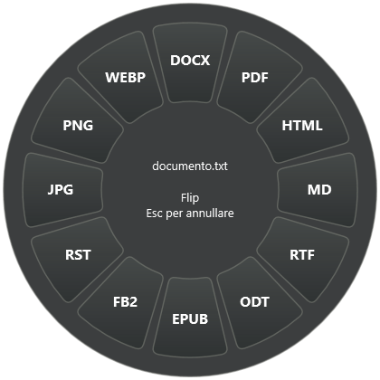

**English** · [Italiano](README.it.md)

# FLIP v0.6.3 — AURA Edition


[](LICENSE)
[](https://www.buymeacoffee.com/1berimHY9M)

FLIP is a local file converter for Windows. Drag one or more files from File Explorer or the desktop, press **Down Arrow** (or your configured key), and drop them on a format in the wheel. By default, FLIP saves the converted copy beside the source.



[Demo video](docs/assets/flip-demo.mp4) · [v0.6.3 release notes](https://github.com/thetinyfoundry/FLIP/releases/tag/v0.6.3) · [Changelog](CHANGELOG.md) · [Windows guide](docs/WINDOWS-INSTALL.md)

## Install or upgrade to v0.6.3

1. Install the [.NET 10 Windows Desktop Runtime x64](https://dotnet.microsoft.com/download/dotnet/10.0) on Windows 10 or 11 x64.
2. Download [`Flip-0.6.3-win-x64.zip`](https://github.com/thetinyfoundry/FLIP/releases/download/v0.6.3/Flip-0.6.3-win-x64.zip) from the [v0.6.3 release](https://github.com/thetinyfoundry/FLIP/releases/tag/v0.6.3) and extract the entire archive.
3. Close FLIP and run `Installa-FLIP.cmd` from the extracted folder. The installer verifies the package and copies it into `%LOCALAPPDATA%\Programs\Flip`.

**Already using FLIP? Update the entire installation to v0.6.3.** Run the installer from the new archive. For a manual installation, replace the entire application folder with the contents of the new `payload` folder. Keep your documents and settings separate from the application folder. From v0.6.3 onwards you can also update from **Settings → Guide & Shortcuts → Updates**. FLIP contacts GitHub only when you press the button.

To uninstall, run `Disinstalla-FLIP.cmd` from the extracted package.

## What's in AURA Edition

- **Screen-edge aura and radial wheel.** The wheel follows the cursor across displays. Press **Tab** or scroll to flip between conversion formats and quick tools, including when the wheel was opened by holding the mouse button. Mixed selections can be grouped by file type.
- **QuickLook.** Press **Space** while dragging to preview a file. Explore 3D models with Orbit and a four-view blueprint, inspect images and their color palettes, or preview text and audio waveforms.
- **Hold-to-open.** Enable it under *Activation & Input* and hold the mouse button on a selected file in File Explorer or on the Desktop (3 seconds by default, adjustable) to open the wheel without pressing any key. A small progress ring appears after half a second; press the right mouse button or Esc to close the wheel.
- **Quick tools.** Crop, rotate, resize, blur sensitive regions, merge PDFs, remove image backgrounds, extract text with OCR, and bundle outputs in ZIP or, when WinRAR is installed, RAR. Selected folders are archived next to the original folder.
- **Optional engines.** If a selected format needs an engine that is not installed, FLIP asks whether to install it before starting the conversion.
- **Archival PDF and offline transcription.** Convert supported files to PDF/A-2b. **Merge PDF** preserves each source page's original size and orientation; press **A** to choose `Original`, A4 or A3, portrait or landscape. With the optional Whisper engine, transcribe audio or video to TXT or SRT locally.
- **Settings and accessibility.** Use the Settings Hub to configure the wheel, output folders, optional engines, watch folders, and recipes. Tobii eye-tracker users can enable dwell selection.

## Formats and engines

| Category | Examples | Engine |
| --- | --- | --- |
| Images | PNG, JPEG, WebP, BMP, TIFF, GIF, ICO | Built in |
| PDF and documents | PDF/A-2b, PDF page images, text extraction, DOCX, ODT, Markdown | Built in, Pandoc or LibreOffice depending on the route |
| Structured data | JSON, JSONL, YAML, TOML, XML, CSV, TSV, INI, XLSX | Built in |
| 3D and vector | OBJ, FBX, STL, PLY, GLB, GLTF, 3MF, DAE, SVG, DXF | Built in |
| Archives | ZIP, TAR, GZ, TGZ, CBZ, 7Z | Built in |
| Audio and video | MP3, WAV, FLAC, MP4, MKV, WebM, offline TXT and SRT | FFmpeg, native Windows media support or Whisper depending on the route |

Available outputs depend on the selected files and installed engines. Conversion runs on your PC. FLIP uses temporary workspace files for processing and saves completed outputs to the configured destination.

## Build from source

Install the [.NET 10 SDK x64](https://dotnet.microsoft.com/download/dotnet/10.0).

```powershell
dotnet build src/Flip/Flip.csproj -c Release -warnaserror
dotnet run --project src/Flip/Flip.csproj -c Release --no-build -- --test-input
dotnet run --project src/Flip/Flip.csproj -c Release --no-build -- --test-conversions
```

[Architecture](ARCHITECTURE.md) · [Contributing](CONTRIBUTING.md)

## Contributors

Thanks to [@AlphaGolf-sec](https://github.com/AlphaGolf-sec) for the second-launch fix in v0.6.1 and in-app updates in v0.6.3, and [@giovamolinaro](https://github.com/giovamolinaro) for the YAML, XML and CSV fix in v0.6.2.

## Support

<a href="https://www.buymeacoffee.com/1berimHY9M"></a>

## License

Starting with v0.6.0, FLIP's original code and assets are licensed under [GNU GPLv3](LICENSE) (`GPL-3.0-only`). Copyright © 2026 The Tiny Foundry / Raffaele Acanfora. [Third-party components](THIRD_PARTY_NOTICES.md) retain their respective licenses.
