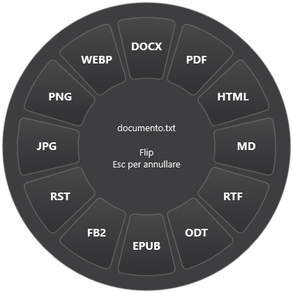

# FLIP for Windows

Convert a file without leaving Explorer. Drag it, press **Down Arrow**, and drop it on a format in the wheel. FLIP saves a new copy beside the original.

FLIP is a local file converter for Windows x64. The current version is **0.5.1**.

[Download the demo (MP4)](docs/assets/flip-demo.mp4) · [Italiano](README.it.md) · [Installation guide](docs/WINDOWS-INSTALL.md) · [Changelog](CHANGELOG.md)

---

## Fixes in 0.5.1

- Fixed direct PowerShell installation from the extracted ZIP. Double-click `Install-FLIP.cmd` for the standard setup.
- Fixed FFmpeg detection in the documented per-user tools folder, so conversions such as MP4 to MP3 are available when FFmpeg is installed there.
- DOCX to PDF now defaults to A4.
- The multiple-conversion window explains how to open the wheel using the configured shortcut.

## 🌟 What's new in v0.5.0-beta.1

- **Audio & Video conversion**: convert between video formats (MP4, MKV, WebM, AVI, MOV) and audio formats (MP3, WAV, FLAC, OGG, M4A, AAC), or extract audio tracks from video files on the fly with local FFmpeg.
- **Native structured-data conversions**: bidirectionally convert JSON, YAML, XML, and CSV, or export them to PDF, HTML, Markdown, and TXT with zero external dependencies.
- **Animated radial progress arc**: the wheel stays open during long conversions and displays an animated sweep line, a smooth circular progress arc, and a real-time percentage counter with a green completion checkmark.
- **In-app GitHub update checker**: right-click the tray icon and select *"Verifica aggiornamenti su GitHub…"* to check for new releases.
- **Reliable audio feedback**: restored tactile tick using modern WASAPI/Media Foundation audio playback.

---

## Download and install

**[Download FLIP 0.5.1 for Windows x64](https://github.com/thetinyfoundry/FLIP/releases/download/v0.5.1/Flip-0.5.1-win-x64.zip)** · [Release notes and checksum](https://github.com/thetinyfoundry/FLIP/releases/tag/v0.5.1)

1. Open [Releases](https://github.com/thetinyfoundry/FLIP/releases), download the `Flip-0.5.1-win-x64.zip` archive and extract it.
2. Install the [.NET 10 Windows Desktop Runtime x64](https://dotnet.microsoft.com/download/dotnet/10.0) if not already installed.
3. Exit FLIP from its tray menu if it is running, then double-click `Install-FLIP.cmd` in the extracted folder. Open FLIP from the Desktop or Start menu shortcut. You do not need the SDK or a compiler to run the packaged app.

### Optional engines:
- **Audio & Video**: Place `ffmpeg.exe` in `%LOCALAPPDATA%\Flip\tools` and restart FLIP. FLIP also detects FFmpeg installed through WinGet or available on PATH.
- **Documents (Pandoc & LibreOffice)**: close FLIP and run `Install-DocumentEngine.ps1` from the package to download official Pandoc. LibreOffice provides document rendering.

---

## Build from source

Install the [.NET 10 SDK for Windows x64](https://dotnet.microsoft.com/download/dotnet/10.0), clone or download this repository, and open PowerShell in the project folder:

~~~powershell
.\scripts\Build.ps1 -DocumentEngine
.\scripts\Install.ps1
~~~

The installer copies FLIP to `%LOCALAPPDATA%\Programs\Flip`, creates Desktop and Start Menu shortcuts, and enables startup when you sign in to Windows. Use `-NoShortcuts` or `-NoStartup` to opt out.

FLIP stays in the notification area near the clock. Right-click its icon to open Settings, choose a shortcut, change the language, test the wheel sound or check for GitHub updates.

---

## Use the wheel

1. Select one or more files in Explorer or on the Desktop.
2. Start dragging and press **Down Arrow** (or your custom shortcut). Release the key when the wheel appears.
3. Hover over an available output format and drop.
4. During conversion, watch the circular progress arc and percentage indicator. Press **Escape** at any time to cancel.

FLIP reserves the selected key during Explorer/Desktop mouse gestures. Outside that context it passes keyboard input through.

Output names include `.converted` and a number when needed. FLIP **never** overwrites the original or an existing output.

---

## Supported conversions

| Category | Input Formats | Available Outputs | Engine |
| --- | --- | --- | --- |
| **Images** | PNG, JPG/JPEG, WebP, BMP, TIFF, GIF | PNG, JPG, WebP, PDF, BMP, TIFF, GIF (excluding source) | Native SkiaSharp |
| **Structured Data** | JSON, YAML/YML, XML, CSV | JSON, YAML, XML, CSV, TXT, HTML, Markdown, PDF | Built-in |
| **Audio** | MP3, WAV, FLAC, OGG, M4A, AAC, WMA, OPUS | WAV, MP3, FLAC, OGG, M4A, AAC | Local FFmpeg |
| **Video** | MP4, MKV, WebM, AVI, MOV, WMV, M4V | MP4, MKV, WebM, AVI, MOV, plus MP3 and WAV audio extraction | Local FFmpeg |
| **Plain Text** | TXT | PDF, PNG, JPG, WebP (core); DOCX, EPUB, Markdown, HTML, ODT, RTF, FB2, RST (Pandoc) | Core / Pandoc |
| **Documents** | Markdown, HTML, DOCX, EPUB, ODT, RTF, FB2, RST | Other document formats with Pandoc; rendering to PDF/images requires LibreOffice | Pandoc / LibreOffice |
| **PDF** | PDF | PNG/JPG/WebP per page and extracted TXT; other document formats with Pandoc | Native / Pandoc |

---

## Privacy and local execution

All conversions run **100% locally** on your machine without third-party cloud services or account requirements. Converted files remain safely in their original folder.

Runtime diagnostic logs are stored under `%LOCALAPPDATA%\Flip\logs`. Review and redact logs before sharing.

---

## License

FLIP's own code and original assets use the [MIT License](LICENSE). Third-party components retain their respective licenses. See [THIRD_PARTY_NOTICES.md](THIRD_PARTY_NOTICES.md).

[Contributing](CONTRIBUTING.md) · [Changelog](CHANGELOG.md) · [Architecture](ARCHITECTURE.md)
